# BankPulse: term deposit propensity on AWS SageMaker

[](pyproject.toml)
[](#architecture)
[](#model-development)
[](#testing-and-quality)
[](LICENSE)

An end-to-end MLOps system that predicts whether a bank customer will open a term deposit **before** the sales call, so a campaign team can call the most promising customers first.

- **Data:** a tested Python framework prepares and validates the data.
- **AWS:** SageMaker trains, scores, governs, serves and monitors the model, with S3, CloudWatch and EventBridge.
- **Retraining:** a SageMaker Pipeline retrains on new monthly data while the live endpoint keeps serving the approved model.

**[Demo video](docs/video-demo/bankpulse_vedio_demo.webm)** · **[Screenshots](docs/screenshots/README.md)** · **[Executed notebooks](notebooks/executed/)** · **[Retraining design](docs/retraining.md)**

> **Status:** v1.0. Every stage ran end to end in an AWS Academy Learner Lab (`us-east-1`). Lab accounts are temporary, so the account IDs and ARNs in the screenshots and executed notebooks no longer exist.

---

## Table of contents

- [Overview](#overview)
- [Key results](#key-results)
- [Architecture](#architecture)
- [Getting started](#getting-started)
- [Configuration](#configuration)
- [Project structure](#project-structure)
- [Data](#data)
- [Feature engineering](#feature-engineering)
- [Model development](#model-development)
- [Deployment and inference](#deployment-and-inference)
- [Monitoring](#monitoring)
- [Continuous training](#continuous-training)
- [Results UI](#results-ui)
- [Testing and quality](#testing-and-quality)
- [Security](#security)
- [Cost management](#cost-management)
- [Troubleshooting](#troubleshooting)
- [Limitations and responsible use](#limitations-and-responsible-use)
- [Roadmap](#roadmap)
- [Screenshots](#screenshots)
- [Contributing](#contributing)
- [License and citation](#license-and-citation)

---

## Overview

**Problem.** A bank sells term deposits by phone, and only about **1 in 9** calls ends in a subscription. Agents work through call lists in no particular order, so most of their effort goes on customers who were never going to say yes.

**Solution.** A binary classifier scores each customer's probability of subscribing, using only information known **before** the call.
- **Excluded:** call duration, which is only known after the call, is left out to prevent target leakage.
- **Ranking:** customers above a threshold chosen on validation data are flagged **call first**, and the rest are ranked by score.

| Audience | What they get |
|---|---|
| Campaign managers | A ranked call list and the expected subscribers at each cut-off |
| Call-centre agents | Who to call next, highest score first |
| Data science / MLOps | Training, registry, endpoint, drift and retraining status in one place |
| Risk and compliance | Model Card, recorded approval decisions, selection rates by age band |

## Key results

Both models use the same 68 inputs. The threshold is chosen on validation, and test (the newest 15% of calls) is evaluated once.

| Metric | Logistic baseline | SageMaker XGBoost |
|---|---|---|
| Validation PR-AUC | 0.222 | **0.228** |
| Test PR-AUC | **0.471** | 0.467 |
| Test F1 at the validation threshold | 0.306 | **0.369** |
| Test recall | 0.224 | **0.302** |
| Test lift, top 10% | 1.19× | **1.24×** |
| Subscribers found on test (true positives) | 533 | **718 (+35%)** |

- **Serving parity:** the real-time endpoint returns the same scores as Batch Transform for the same customers (maximum difference 0.0).
- **Retraining:** on each new month, a model retrained on the latest 12 months beats the deployed model by **0.16–0.24 PR-AUC** on the newest holdout.
- **Monitoring:** live traffic shows strong drift (17 inputs with PSI > 0.2), and an age-band selection ratio of 0.30, which is flagged for fairness review.

## Architecture


| Layer | Components |
|---|---|
| Data framework (local, tested) | Data contract, time-ordered split, versioned feature registry, pipeline with lineage |
| Data lake | Amazon S3 (`bank-campaign-mlops/`) |
| Training and evaluation | SageMaker Training Job (built-in XGBoost 1.7-1), Batch Transform |
| Governance | SageMaker Model Registry (versioning, approval), SageMaker Model Card |
| Serving | SageMaker Model, Endpoint Configuration, real-time Endpoint with Data Capture |
| Monitoring | Drift and subgroup report; CloudWatch metrics, alarm and dashboard; Model Monitor baseline |
| Continuous training | SageMaker Pipelines, EventBridge triggers, champion vs challenger evaluation |
| Interface | Streamlit results UI (live, read-only AWS status; scoring with the endpoint) |

The framework (`bankpulse_core/`) never imports the business features (`features/`). Which features run, and in which version, is set in `config/data_prep.yaml`, so adding or upgrading a feature needs no pipeline change.

## Getting started

### Prerequisites

- Python 3.10 or newer (developed on 3.11)
- An AWS account with SageMaker access, needed only for the SageMaker steps. The project was built on an AWS Academy Learner Lab using its `LabRole`.
- Git. The AWS CLI is optional, since all AWS checks run in Python.

### Installation

```bash
git clone https://github.com/aishwaryagulhane05/bankpulse-sagemaker-mlops.git
cd bankpulse-sagemaker-mlops
python -m venv .venv
.venv\Scripts\activate            # Windows; on macOS / Linux: source .venv/bin/activate
pip install -r requirements.txt
pip install -e .
```

### Quickstart (local, no AWS)

```bash
pytest -q                           # 266 tests
python scripts/quality_report.py    # data contract checks + quality report
python scripts/baseline.py          # data pipeline + logistic baseline
python scripts/tune_xgboost.py      # validation-only hyperparameter search
streamlit run ui/app.py             # results UI (offline mode: saved reports)
```

Outputs go to `data/processed/` (git-ignored) and `reports/`.

### Connect to AWS

No credentials are stored in the repository. For each lab session:

1. **Copy the credentials:** in AWS Academy, start the lab, open **AWS Details → AWS CLI: Show**, and paste the three values into `~/.aws/credentials` under `[bankpulse-lab]`. The file has no extension.
2. **Set the region (once only):** in `~/.aws/config`, add a section `[profile bankpulse-lab]` containing the line `region = us-east-1`.
3. **Check the connection:** run `python scripts/check_aws.py`. It checks the credentials, region, role, SageMaker access and default bucket, and prints no secrets.

The code picks the `bankpulse-lab` profile automatically and runs SageMaker jobs as `LabRole`. Set `BANKPULSE_ROLE_ARN` only if you need a different role. The notebooks also run unchanged inside SageMaker Studio, where Studio's execution role is used.

### Run the end-to-end workflow

Run the notebooks in order. Each one saves what the next needs in `data/processed/sagemaker_state.json`.

| Notebook | What it does in AWS | Typical run time |
|---|---|---|
| `01_data_preparation` | Quality report, pipeline run, upload to the S3 data lake | 1 min |
| `02_training_evaluation` | Training job, two Batch Transform jobs, evaluation against the baseline | 12 min |
| `03_model_registry` | Model package group, model version with metrics, approval, Model Card | 1 min |
| `04_inference_capture` | Endpoint with Data Capture, scores 200 new customers, confirms capture | 8 min |
| `05_bias_drift_monitoring` | Monitoring report, CloudWatch metrics, alarm and dashboard, Model Monitor attempt, clean-up | 10 min |
| `06_continuous_training` | Retraining triggers, pipeline executions, version history | 1 min (after the pipeline runs) |

The retraining pipeline and its triggers are created from the command line:

```bash
python scripts/simulate_arrivals.py --history 23      # months 1-23 as accepted batches
python -m pipelines.retrain_pipeline --start          # create or update the pipeline and run it
python -m pipelines.triggers                          # S3-upload, monthly and drift-alarm triggers
python scripts/simulate_arrivals.py --arrive 24       # a new month lands; the pipeline starts by itself
```

## Configuration

| File | Purpose |
|---|---|
| `config/data_prep.yaml` | Data source and separator, contract path, split fractions, output folders, S3 prefix, log level, feature package, and the **enabled features with their versions**. Optional `data.batches` and `window` settings switch to a rolling window of monthly batches |
| `config/contract.yaml` | All 21 columns with types, allowed values and ranges, the target and positive label, forbidden columns (`duration`), sentinels (`pdays = 999`), and 4 business rules |
| `reports/xgboost_tuning.json` | The hyperparameters used by the training job and the pipeline, chosen on validation |

| Environment variable | Default | Use |
|---|---|---|
| `AWS_PROFILE` | `bankpulse-lab`, set by the code if that profile exists | AWS credentials profile |
| `BANKPULSE_ROLE_ARN` | `LabRole` in the signed-in account | Use a different role for SageMaker jobs |
| `SAGEMAKER_SUPPRESS_V2_WARNING` | unset | Set it to `1` to hide the SageMaker SDK v2 deprecation notice |

## Project structure

```
bankpulse-sagemaker-mlops/
├── architecture/        make_diagram.py -> architecture.png
├── bankpulse_core/      framework: config, io, aws, contract, split, encoding, feature_base,
│                        ingest, pipeline, lineage, evaluation, monitoring, log_utils
├── features/            business features: contact_history, campaign, economic, client_profile
├── pipelines/           retrain_pipeline (SageMaker Pipeline), steps/ (prepare, evaluate), triggers, deploy
├── ui/                  Streamlit results UI: app, tracking (read-only AWS status), scoring, content
├── config/              data_prep.yaml, contract.yaml
├── data/raw/            dataset and column descriptions (data/processed/ is generated and git-ignored)
├── notebooks/           01-06 without outputs; executed/ holds the same notebooks with the lab run's outputs
├── scripts/             check_aws, quality_report, baseline, tune_xgboost, simulate_arrivals
├── reports/             quality, baseline, tuning, XGBoost, comparison, monitoring results (JSON)
├── docs/                retraining.md, screenshots/, video-demo/
├── tests/               core/, features/, integration/, ui/, pipelines/
├── pyproject.toml       installable package (pip install -e .)
└── requirements.txt
```

<details>
<summary>S3 data lake layout</summary>

```
s3://sagemaker-<region>-<account>/bank-campaign-mlops/
├── raw/                 original CSV; batches/ (accepted monthly files + manifest), incoming/, rejected/
├── train/  validation/  label-first XGBoost files (one per folder = one training channel)
├── batch-input/         feature-only files for Batch Transform
├── labels/              validation and test labels for evaluation
├── feature-schema/      column order and feature states, used by the endpoint
├── run-metadata/        lineage of the pipeline run
├── model-artifacts/     model.tar.gz from the training job
├── batch-predictions/   Batch Transform .out files
├── reports/             metrics, comparison, model-quality JSON for the registry
├── inference-capture/   Data Capture JSON Lines from the endpoint
├── model-monitor/       Model Monitor baseline statistics and constraints
├── monitoring-reports/  dated monitoring reports
└── retraining/          per-execution pipeline outputs and challenger model artifacts
```
</details>

## Data

[UCI Bank Marketing](https://archive.ics.uci.edu/dataset/222/bank+marketing), `bank-additional-full.csv` (Moro, Cortez & Rita, 2014).

| Property | Value |
|---|---|
| Records | 41,188 phone contacts in date order, May 2008 – November 2010 (26 calendar months) |
| Columns | 20 inputs and the target `y` (yes / no) |
| Positive rate | 11.27% overall; **5.6% train, 10.7% validation, 38.5% test**, which is strong drift over time |
| Quality | no missing values; 12 duplicate rows; `unknown` in 6 categorical columns (up to 20.9%); `pdays = 999` (never contacted) in 96.3% of rows |

**Split.** Time-ordered: the oldest 70% of rows train, the next 15% validate and the newest 15% test. A random split would leak future behaviour into training.

**Data contract.** Every run validates the schema, types, allowed values, ranges and 4 cross-column rules, then drops the forbidden `duration`. Problems are all listed at once. During retraining, an invalid file is rejected with a report and never used.

## Feature engineering

Nine features are enabled, giving 68 model inputs. Every learned value (caps, category lists) is fitted on the training split only and saved in `feature_schema.json`, so the endpoint encodes customers exactly like the training data.

| Feature | Version | Inputs | Output |
|---|---|---|---|
| `previously_contacted` | v1 | `pdays` | 1 unless `pdays` is the 999 "never contacted" value |
| `prior_success` | v1 | `poutcome` | 1 if the previous campaign succeeded |
| `previous_contacts` | v1 | `previous` | Raw count |
| `campaign_intensity` | v1 | `campaign` | Raw count |
| `capped_campaign` | v1 (v2 available) | `campaign` | Clipped at the training 99th percentile (v2 then applies `log1p`) |
| `age` | v1 | `age` | Raw age |
| `age_band` | v1 | `age` | One-hot: `<30`, `30-44`, `45-59`, `60+` |
| `categorical_profile` | v1 | `job`, `marital`, `education`, `default`, `housing`, `loan` | One-hot, with an `__other` column for unseen values |
| `contact_timing` | v1 | `contact`, `month`, `day_of_week` | One-hot, with an `__other` column for unseen values |

**Not enabled: economic indicators.** `euribor_rate`, `employment_level` and `economic_indicators` are registered but switched off.
- **Why:** they describe the *period* of the call, not the customer. With a time-ordered split, every later value is outside the training range (PSI 8–17), so trees use them as a clock.
- **Effect:** validation PR-AUC is 0.177 with them and 0.229 without.

## Model development

- **Algorithm:** SageMaker built-in XGBoost 1.7-1 (`binary:logistic`) on `ml.m5.large`, with early stopping on validation `aucpr`.
- **Hyperparameters:** chosen by `scripts/tune_xgboost.py`, a 64-setting grid scored on **validation PR-AUC only**, using local XGBoost 1.7.6, the same version as the container. Result: `max_depth=4, eta=0.05, min_child_weight=1, colsample_bytree=0.5, subsample=0.8`.
- **Threshold:** 0.106, the best F1 on validation, reused unchanged on test.
- **Baseline:** scaled logistic regression on the same features (`scripts/baseline.py`).
- **Approval rule:** non-inferiority. Approve if test PR-AUC is no more than 0.01 below the baseline's.
  - The result was −0.0039, so the model was approved.
  - The margin was set after the first results, and the registry's approval note says so. A strict "must beat the baseline" rule would have rejected the model.
- **Governance:** the model version is registered with model-quality metrics and custom metadata (threshold, training job, pipeline git commit). The Model Card records intended use ("not for credit, lending, pricing or eligibility decisions"), a Medium risk rating, the evaluation results and the caveats.

## Deployment and inference

- **Endpoint:** the approved registry version is deployed to a real-time endpoint (`ml.m5.large`), with **Data Capture** of 100% of requests and responses into S3.
- **Encoding:** `bankpulse_core.pipeline.encode_records()` turns raw customer records into model rows using the saved feature schema. An integration test checks they're byte-identical to the batch files.
- **Batch scoring:** Batch Transform scores whole files offline (validation and test) with the same model.

## Monitoring

Built from the endpoint's captured traffic (the newest 200 customers) against the training data, in `reports/monitoring_report.json`:

| Metric | Value | Status |
|---|---|---|
| Max feature PSI | 3.43 (`previous_contacts`) | Alert: 17 inputs above 0.2 |
| Prediction PSI | 2.95 (mean score 0.07 → 0.25) | Alert |
| Age-band selection ratio (min/max) | 0.30 (60+ 77%, 45–59 23%) | Alert: below 0.8, fairness review needed |

- **CloudWatch:**
  - **Metrics:** the four headline values under `BankPulse/ModelMonitoring`.
  - **Alarm:** `<endpoint>-feature-drift`, which fires when max PSI is above 0.2.
  - **Dashboard:** `bankpulse-model-monitoring`.
- **Managed SageMaker monitoring:** the Model Monitor baseline job completed. AWS rejected the monitoring schedule and the Clarify bias job for new accounts ("maintenance mode"). The custom report covers the same checks (`reports/managed_monitoring_attempts.json`).

## Continuous training

New data arrives after deployment, so the model retrains on recent data while the endpoint keeps serving the approved version. Design: [docs/retraining.md](docs/retraining.md).

```
new month in raw/incoming/ ─┐
monthly schedule ───────────┼─> EventBridge ─> SageMaker Pipeline "bankpulse-retrain":
drift alarm (PSI > 0.2) ────┘     Prepare -> Train -> Evaluate (challenger vs champion) -> Check -> Register
                                  (PendingManualApproval) -> human approval -> blue/green deploy
```

- **Ingest:** each new file is checked against the data contract. Accepted files are copied byte for byte to `raw/batches/` and listed in a manifest with their SHA-256; duplicates are skipped and invalid files are reported. Nothing is deleted.
- **Rolling window:** train on the latest 12 months, validate on the next 2, and hold out the newest 2. Older months age out.
- **Champion vs challenger:** the deployed model and the challenger score the same holdout, each with its own feature schema and its own validation threshold.
- **Registration rule:** the challenger is registered only if its holdout PR-AUC is no more than 0.01 below the champion's, and its age-band ratio is not worse than the champion's or is at least 0.8.
- **Safe deployment:** `pipelines/deploy.py` runs a blue/green canary (10% of traffic for 10 minutes) with automatic rollback on 5XX and p99-latency alarms, and has a one-call manual rollback.

**Replay in the lab.** Months 24, 25 and 26 arrived one at a time. The uploads of months 25 and 26 started the pipeline by themselves; month 24 was started by hand.

| Execution | Trigger | Champion PR-AUC | Challenger PR-AUC | Challenger lift | Registered |
|---|---|---|---|---|---|
| `3wjs5sh014r7` | month 24 (manual) | 0.588 | **0.751** | 1.76× | version 2 |
| `pyc11ujznp6j` | month 25 (S3 upload) | 0.489 | **0.732** | 1.71× | version 3 |
| `akymeu81c6aa` | `capped_campaign v2` | 0.489 | **0.732** | 1.71× | version 4 |
| `9ccdjy4g6i50` | month 26 (S3 upload) | 0.474 | **0.660** | 1.53× | version 5 |

- **v2 feature:** `capped_campaign v2` (log1p) gives identical results to v1, because tree splits don't change under a monotonic transform, so v1 stays.
- **Approval state:** version 5 was later approved in the registry. Versions 2–4 await approval. The endpoint keeps serving version 1 until a deliberate deploy.

## Results UI

```bash
streamlit run ui/app.py
```

| Section | What it shows |
|---|---|
| Overview | The problem, why it matters, the audience, how it helps, and what it must not be used for |
| SageMaker tracking | **Live, read-only** status: data lake, training job and hyperparameters, Batch Transform, registry versions, Model Card, endpoint and Data Capture, retraining triggers and pipeline runs, with console links |
| Model results | Baseline vs XGBoost per split, confusion matrices, the hyperparameter search |
| Monitoring | PSI per feature, age-band selection rates, alerts, the live CloudWatch alarm and metrics |
| Score customers | One customer from a form (pre-call fields only), or the newest N customers, scored by the **live endpoint** |

Without credentials, the app shows the saved reports. With a valid `[bankpulse-lab]` profile, it reads live status. It re-reads the credentials every 5 minutes, or when you click **Refresh live status**, because lab keys change every session.

## Testing and quality

```bash
pytest -q          # 266 tests, no AWS access needed
```

| Suite | Covers |
|---|---|
| `tests/core/` | Contract, split and rolling window, encoding, feature registry, pipeline, lineage, I/O (with a fake S3), evaluation, monitoring, AWS helpers, ingest |
| `tests/features/` | Every feature, the enabled-feature config, training-only state |
| `tests/integration/` | Full pipeline on the real data: reproducible output hashes, endpoint encoding byte-identical to the batch files, rolling window over monthly batches, a broken input failing safely |
| `tests/ui/` | Tracking and scoring with fake AWS clients; an offline smoke test of every UI section |
| `tests/pipelines/` | Deploy, rollback and triggers with fake clients; the Processing-job code bundle |

**Reproducibility:**
- Every pipeline run writes `run_metadata.json`, with the raw-data and output SHA-256 hashes, git commit, config and feature versions.
- The same raw file always produces byte-identical outputs.
- Files are written with `\n` line endings, so hashes match across Windows and Linux.

## Security

- **No credentials in code, config or the repository.** AWS access uses the default credential chain, through the `bankpulse-lab` profile or the Studio execution role.
- **Least surprise:**
  - The UI and the tracking code only describe and list AWS resources.
  - Nothing that changes the live endpoint runs automatically: deployment requires human approval and an explicit deploy step.
- **Git-ignored:** account-specific state (`data/processed/sagemaker_state.json`) and local secrets (`.env`).
- **Lab accounts:** the screenshots and executed notebooks show a temporary AWS Academy account ID. They contain no keys or tokens.

## Cost management

| Resource | Billing | Notes |
|---|---|---|
| Training, Batch Transform, Processing jobs | Only while running | Each job has `max_run` of 1 hour |
| Real-time endpoint (`ml.m5.large`) | **Every hour until deleted** | It keeps billing after the lab session ends |
| Retraining pipeline run | About 12 minutes of `ml.m5.large` per run | Triggered by uploads, the monthly schedule or the drift alarm |
| S3, registry, Model Card, CloudWatch | Negligible | Kept as the project record |

**Clean-up:** in notebook 05, run the setup cell, set `CLEAN_UP = True` in the last cell, and run only that cell.
- **Deletes:** the endpoint, its configuration and its model.
- **Disables:** the retraining triggers. They're not deleted, so they can be re-enabled.
- **Prints:** what is still running, as a final check.

## Troubleshooting

| Symptom | Cause | Fix |
|---|---|---|
| `profile 'bankpulse-lab' not found` | The credentials file was saved as `credentials.txt` | Rename it to `credentials`, with no extension |
| `AccessDenied` / `ExpiredToken` | The lab session ended or restarted | Paste new values from **AWS Details**, then click **Refresh live status** in the UI |
| `module 'sagemaker' has no attribute 'Session'` | Leftover SageMaker v3 packages removed `sagemaker/__init__.py` | `pip install --force-reinstall --no-deps "sagemaker==2.257.7"` |
| Processing job fails with `numpy.core.multiarray failed to import` | A pandas wheel built for NumPy 2 in the XGBoost container | The bundle pins `pandas==2.0.3`; keep that pin |
| Training job PR-AUC far below the baseline | Period-level inputs act as a clock under a time-ordered split | Keep the economic indicators disabled (see [Feature engineering](#feature-engineering)) |

## Limitations and responsible use

- **Drift:** the test period's subscription rate (38%) is about seven times training's (6%), so absolute scores don't transfer across periods. Retraining on recent data is required.
- **Modest ranking quality:** test PR-AUC is about 0.47 against a 0.38 base rate. The model prioritises calls; it doesn't predict individual outcomes.
- **Month dominates:** the same customer can score 41% in October and 14% in June. The month partly reflects the campaign period, not the customer.
- **Small live sample:** monitoring used 200 captured customers, so the age-band rates are indicative only.
- **Data scope:** one Portuguese bank, 2008–2010, during a financial crisis.
- **Intended use:** ranking marketing call lists that campaign staff review. It is **not** for credit, lending, pricing or eligibility decisions. Age and job are inputs, so selection rates by age band are monitored, and a ratio below 0.8 requires review.

## Roadmap

- [ ] Wire `pipelines/deploy.py` to registry approvals (EventBridge → Lambda), and verify a canary deploy and rollback in the lab (#98)
- [ ] Validate the data-contract business rules in the UI's scoring form, so inconsistent customers can't be scored
- [ ] Load the deployed version's feature schema from the endpoint tag in the UI and notebooks
- [ ] Re-run monitoring on the new training window after a retrained version is deployed

## Screenshots

Full captions: [docs/screenshots](docs/screenshots/README.md). Executed notebooks with every output: [`notebooks/executed/`](notebooks/executed/). Demo video: [docs/video-demo/bankpulse_vedio_demo.webm](docs/video-demo/bankpulse_vedio_demo.webm) (download to play).

<details>
<summary><b>Notebook 01: S3 data lake</b> (4)</summary>

<table>
<tr><td width="50%"><a href="docs/screenshots/01-sagemaker-session-role-bucket.png"></a><br><sub>Session, LabRole and bucket</sub></td><td width="50%"><a href="docs/screenshots/01-s3-data-lake-folders.png"></a><br><sub>S3 data lake folders</sub></td></tr>
<tr><td width="50%"><a href="docs/screenshots/01-s3-data-lake-folders-continued.png"></a><br><sub>S3 data lake folders (continued)</sub></td><td width="50%"><a href="docs/screenshots/01-s3-labels.png"></a><br><sub>Labels kept apart from features</sub></td></tr>
</table>
</details>

<details>
<summary><b>Notebook 02: training job and Batch Transform</b> (7)</summary>

<table>
<tr><td width="50%"><a href="docs/screenshots/02-training-job-completed.png"></a><br><sub>Training job Completed</sub></td><td width="50%"><a href="docs/screenshots/02-training-job-metrics.png"></a><br><sub>Training metrics (PR-AUC)</sub></td></tr>
<tr><td width="50%"><a href="docs/screenshots/02-training-job-input-channels.png"></a><br><sub>Train and validation channels</sub></td><td width="50%"><a href="docs/screenshots/02-training-job-output-artifact.png"></a><br><sub>model.tar.gz and LabRole</sub></td></tr>
<tr><td width="50%"><a href="docs/screenshots/02-s3-model-artifacts.png"></a><br><sub>Model artifacts in S3</sub></td><td width="50%"><a href="docs/screenshots/02-batch-transform-jobs.png"></a><br><sub>Batch Transform jobs Completed</sub></td></tr>
<tr><td width="50%"><a href="docs/screenshots/02-s3-batch-predictions.png"></a><br><sub>Batch predictions (.out)</sub></td></tr>
</table>
</details>

<details>
<summary><b>Notebook 03: Model Registry and Model Card</b> (4)</summary>

<table>
<tr><td width="50%"><a href="docs/screenshots/03-model-registry-group.png"></a><br><sub>Model Registry group</sub></td><td width="50%"><a href="docs/screenshots/03-model-registry-versions.png"></a><br><sub>Versions: v1 Approved, v2-v4 Pending</sub></td></tr>
<tr><td width="50%"><a href="docs/screenshots/03-model-card-overview.png"></a><br><sub>Model Card overview</sub></td><td width="50%"><a href="docs/screenshots/03-model-cards-list.png"></a><br><sub>Model Card, risk Medium</sub></td></tr>
</table>
</details>

<details>
<summary><b>Notebook 04: real-time endpoint and Data Capture</b> (7)</summary>

<table>
<tr><td width="50%"><a href="docs/screenshots/04-sagemaker-model-from-package.png"></a><br><sub>Model from package version 1</sub></td><td width="50%"><a href="docs/screenshots/04-endpoints-inservice.png"></a><br><sub>Endpoint InService</sub></td></tr>
<tr><td width="50%"><a href="docs/screenshots/04-endpoint-summary.png"></a><br><sub>Endpoint summary</sub></td><td width="50%"><a href="docs/screenshots/04-endpoint-config-data-capture.png"></a><br><sub>Data Capture active, 100%</sub></td></tr>
<tr><td width="50%"><a href="docs/screenshots/04-scored-customers.png"></a><br><sub>Scored customers</sub></td><td width="50%"><a href="docs/screenshots/04-s3-inference-capture.png"></a><br><sub>inference-capture/ in S3</sub></td></tr>
<tr><td width="50%"><a href="docs/screenshots/04-capture-jsonl-files.png"></a><br><sub>Captured requests (.jsonl)</sub></td></tr>
</table>
</details>

<details>
<summary><b>Notebook 05: monitoring and CloudWatch</b> (3)</summary>

<table>
<tr><td width="50%"><a href="docs/screenshots/05-s3-monitoring-report.png"></a><br><sub>Monitoring report in S3</sub></td><td width="50%"><a href="docs/screenshots/05-cloudwatch-alarms-overview.png"></a><br><sub>CloudWatch alarms overview</sub></td></tr>
<tr><td width="50%"><a href="docs/screenshots/05-cloudwatch-drift-alarm.png"> 0.2"></a><br><sub>Drift alarm: PSI 3.43 > 0.2</sub></td></tr>
</table>
</details>

<details>
<summary><b>Notebook 06: continuous training</b> (6)</summary>

<table>
<tr><td width="50%"><a href="docs/screenshots/06-eventbridge-retrain-rules.png"></a><br><sub>EventBridge retraining rules</sub></td><td width="50%"><a href="docs/screenshots/06-registry-version-2-lineage.png"></a><br><sub>Version 2 lineage</sub></td></tr>
<tr><td width="50%"><a href="docs/screenshots/06-registry-version-5-metrics.png"></a><br><sub>Version 5 metrics</sub></td><td width="50%"><a href="docs/screenshots/06-registry-version-5-approved.png"></a><br><sub>Version 5 approved</sub></td></tr>
<tr><td width="50%"><a href="docs/screenshots/06-registry-version-5-lineage.png"></a><br><sub>Version 5 lineage</sub></td><td width="50%"><a href="docs/screenshots/06-endpoint-unchanged-after-retraining.png"></a><br><sub>Endpoint unchanged after retraining</sub></td></tr>
</table>
</details>

<details>
<summary><b>Results UI: overview and SageMaker tracking</b> (5)</summary>

<table>
<tr><td width="50%"><a href="docs/screenshots/ui-overview.png"></a><br><sub>Results UI overview</sub></td><td width="50%"><a href="docs/screenshots/ui-tracking-data-lake.png">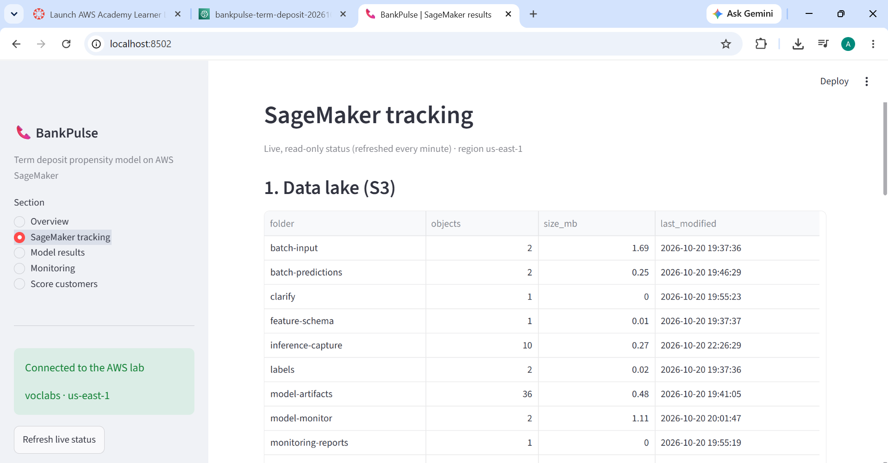</a><br><sub>Tracking: data lake</sub></td></tr>
<tr><td width="50%"><a href="docs/screenshots/ui-tracking-training-job.png">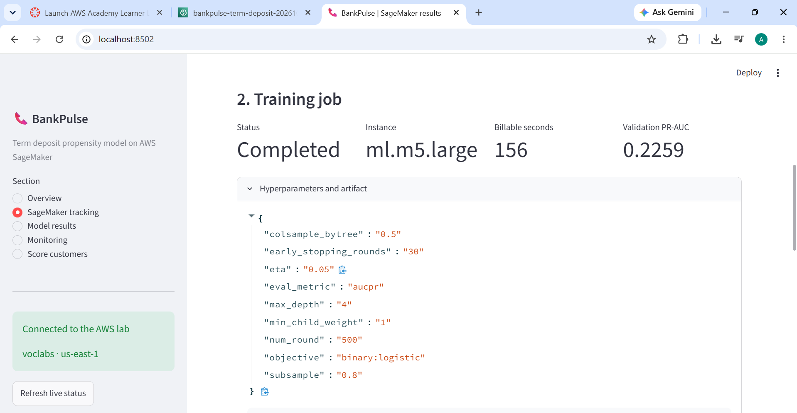</a><br><sub>Tracking: training job and hyperparameters</sub></td><td width="50%"><a href="docs/screenshots/ui-tracking-batch-transform-registry.png">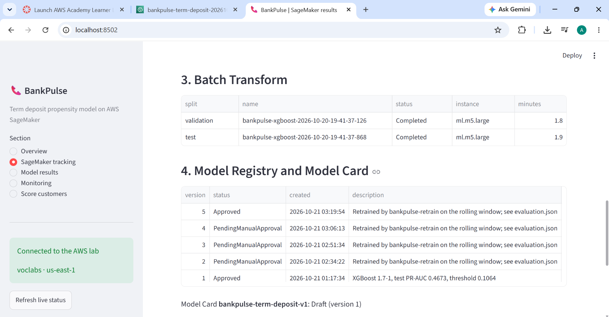</a><br><sub>Tracking: Batch Transform and registry</sub></td></tr>
<tr><td width="50%"><a href="docs/screenshots/ui-tracking-endpoint.png">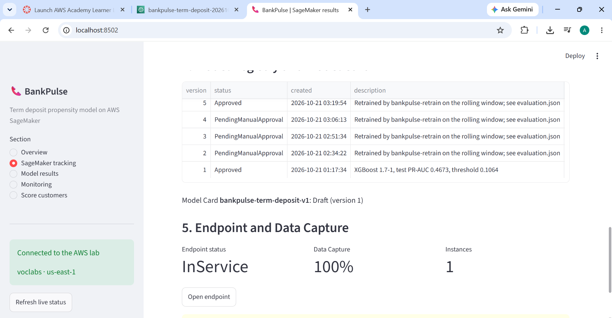</a><br><sub>Tracking: endpoint and Data Capture</sub></td></tr>
</table>
</details>

<details>
<summary><b>Results UI: model results and monitoring</b> (5)</summary>

<table>
<tr><td width="50%"><a href="docs/screenshots/ui-results-confusion-matrices.png">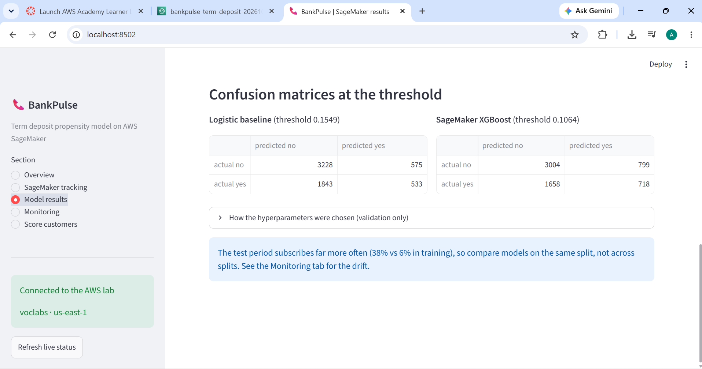</a><br><sub>Results: confusion matrices</sub></td><td width="50%"><a href="docs/screenshots/ui-results-hyperparameter-search.png">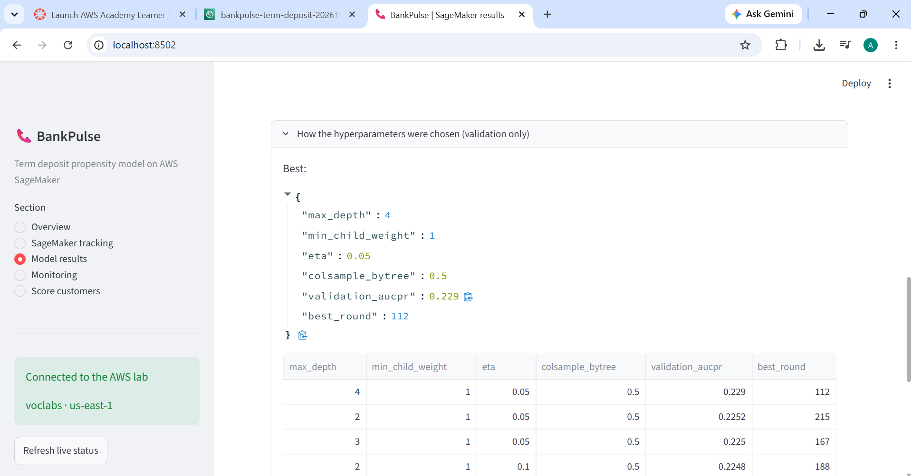</a><br><sub>Results: hyperparameter search</sub></td></tr>
<tr><td width="50%"><a href="docs/screenshots/ui-monitoring-alerts.png">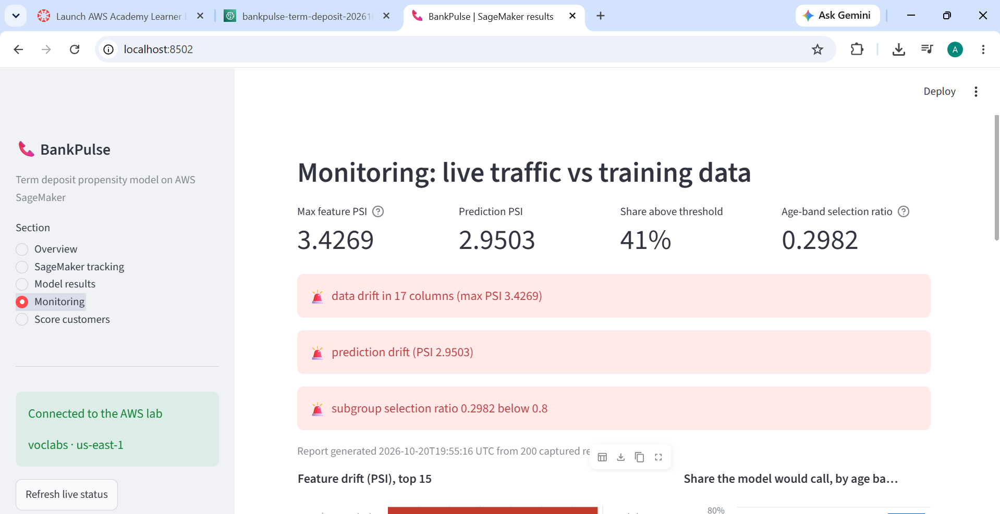</a><br><sub>Monitoring: alerts</sub></td><td width="50%"><a href="docs/screenshots/ui-monitoring-drift-and-age-bands.png">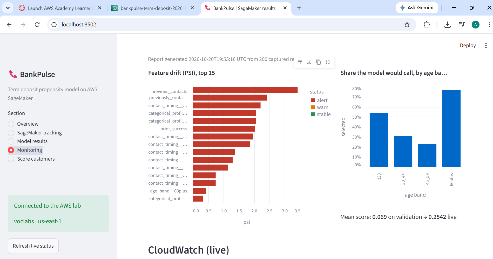</a><br><sub>Monitoring: drift and age bands</sub></td></tr>
<tr><td width="50%"><a href="docs/screenshots/ui-monitoring-cloudwatch.png">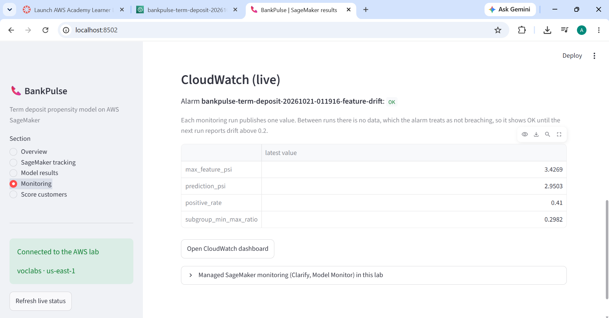</a><br><sub>Monitoring: CloudWatch (live)</sub></td></tr>
</table>
</details>

<details>
<summary><b>Results UI: scoring with the live endpoint</b> (7)</summary>

<table>
<tr><td width="50%"><a href="docs/screenshots/ui-score-form.png">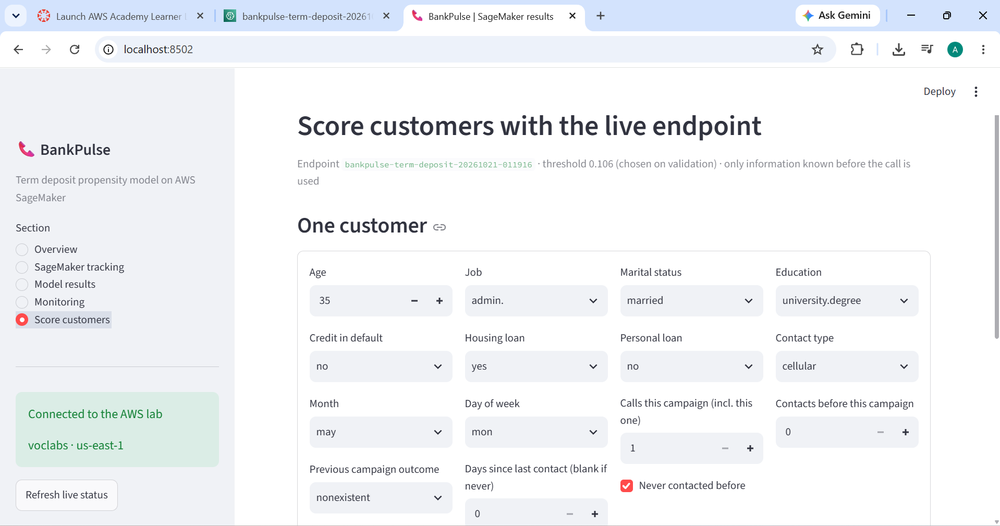</a><br><sub>Score: customer form</sub></td><td width="50%"><a href="docs/screenshots/ui-score-lower-priority.png">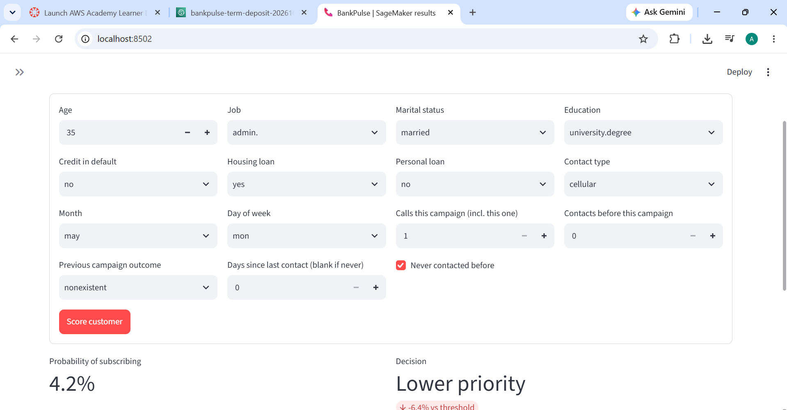</a><br><sub>Score: 4.2%, lower priority</sub></td></tr>
<tr><td width="50%"><a href="docs/screenshots/ui-score-call-first-age-65.png">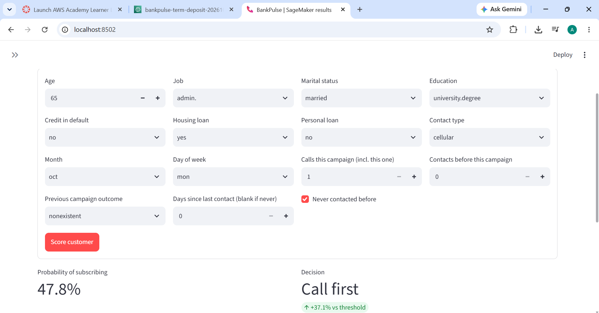</a><br><sub>Score: 47.8%, call first</sub></td><td width="50%"><a href="docs/screenshots/ui-score-call-first-october.png">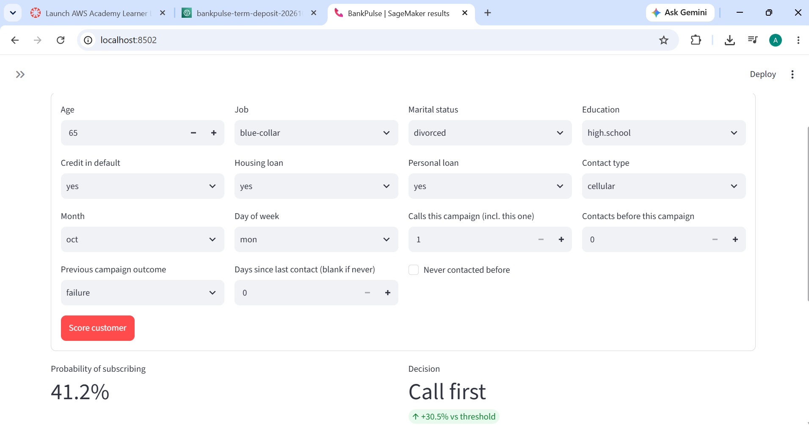</a><br><sub>Score: October, 41.2%</sub></td></tr>
<tr><td width="50%"><a href="docs/screenshots/ui-score-june.png">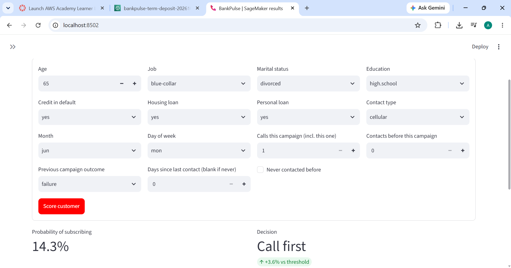</a><br><sub>Score: same customer in June, 14.3%</sub></td><td width="50%"><a href="docs/screenshots/ui-score-newest-customers.png">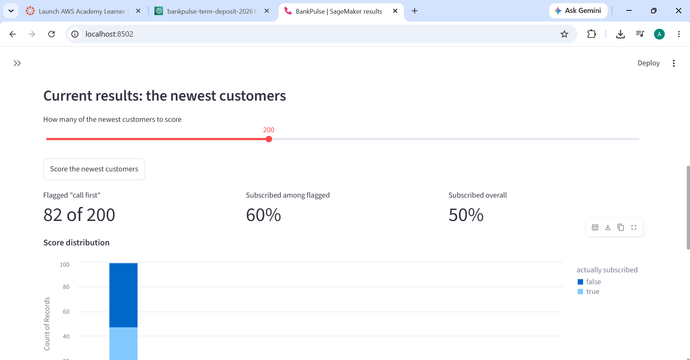</a><br><sub>Score: newest 200 customers</sub></td></tr>
<tr><td width="50%"><a href="docs/screenshots/ui-score-distribution.png">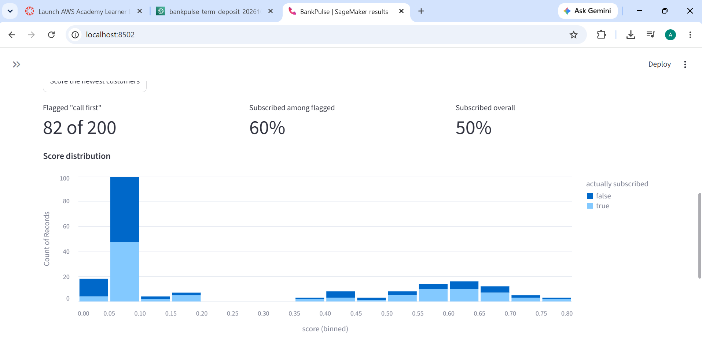</a><br><sub>Score: distribution</sub></td></tr>
</table>
</details>

## Contributing

1. Pick or open an issue. Work is tracked as tickets (`BP-xxx`) grouped by milestone.
2. Branch from `main` (`feature/BP-xxx-short-name`), write the code with tests, and run `pytest -q`.
3. Open a pull request that references the issue (`Closes #N`), and merge after review.
4. Never commit credentials, account-specific state, or executed notebooks containing secrets.

## License and citation

This project is released under the [MIT License](LICENSE).

**Dataset:** Moro, S., Cortez, P., & Rita, P. (2014). A data-driven approach to predict the success of bank telemarketing. *Decision Support Systems, 62*, 22–31. https://doi.org/10.1016/j.dss.2014.03.001. The dataset is available from the [UCI Machine Learning Repository](https://archive.ics.uci.edu/dataset/222/bank+marketing).

**Acknowledgements:** built and run on an AWS Academy Learner Lab.
